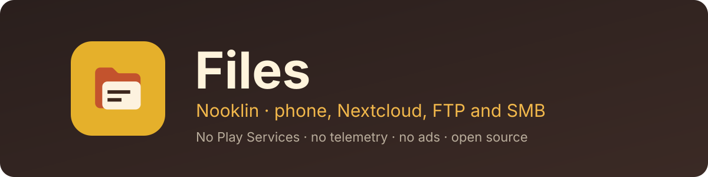

<p align="center">
  
</p>

<h1 align="center">Nooklin Files</h1>

<p align="center">
  A privacy-first, open-source file manager for Android with Nextcloud, FTP and SMB.<br />
  No Google Play Services, no telemetry, no ads.
</p>

<p align="center">
  <a href="https://www.gnu.org/licenses/gpl-3.0"></a>
  
  
  
  <a href="mailto:info@nooklin.org"></a>
</p>

<p align="center">
  <a href="#-install"></a>
  <a href="#-features"></a>
  <a href="#-privacy"></a>
  <a href="CHANGELOG.md"></a>
  <a href="#-get-involved"></a>
</p>

<p align="center"></p>

<h2 align="center">🎯 Our Mission</h2>

<p align="center"><b><i>Your files should stay yours.</i></b></p>

<p align="center">Nooklin Files manages the files on your phone, USB and SD drives, and on your own Nextcloud, FTP and SMB servers. It has its own trash, a text editor, built-in viewers and players, and an App Manager. Nothing is sent anywhere except to a server you add yourself. Part of the <a href="https://github.com/Nooklin">Nooklin</a> suite of free Android apps.</p>

<h2 align="center">🛡️ Principles</h2>

<div align="center">
<table align="center">
  <tr align="center">
    <td align="center" width="25%" valign="top">
      
      <h4 align="center">No Play Services</h4>
      <p align="center">No Google Play Services dependencies.</p>
    </td>
    <td align="center" width="25%" valign="top">
      
      <h4 align="center">No telemetry</h4>
      <p align="center">No analytics, no crash reporting, no tracking.</p>
    </td>
    <td align="center" width="25%" valign="top">
      
      <h4 align="center">No ads</h4>
      <p align="center">Ever.</p>
    </td>
    <td align="center" width="25%" valign="top">
      
      <h4 align="center">Open source</h4>
      <p align="center">GPL-3.0, so every derivative work stays free too.</p>
    </td>
  </tr>
</table>
</div>

<p align="center"></p>

<h2 align="center">📲 Install</h2>

<p align="center">Download the APK from the latest release and check it against the hashes in the release notes (see <a href="#verify-a-release-apk">Verify a release APK</a>), or let Obtainium keep it up to date.</p>

<p align="center">
  <a href="https://github.com/Nooklin/Files/releases/latest"></a>
</p>

<p align="center">
  <a href="https://apps.obtainium.imranr.dev/redirect?r=obtainium://add/https://github.com/Nooklin/Files"></a>
</p>

<p align="center">Requires Android 13 (API 33) or newer.</p>

<p align="center"></p>

<h2 align="center">✨ Features</h2>

- Browse internal storage with a breadcrumb bar, sorting (name, type, size, date) and optional hidden files
- Optional second pane (side by side in landscape, stacked in portrait), copy or move to the other pane
- Copy, move, rename, create folder or file, delete (to own trash or permanently)
- Background copy and move with a notification, progress, speed, remaining time and Cancel
- Conflict prompts per file (overwrite, keep both, skip, apply to all)
- Own trash (Recently Deleted): 30 days, 2 GB or 1000 items, restore or delete permanently
- Zip: compress and extract
- Home: Favorites (folders you add yourself), Locations (On My Phone, USB and SD drives, Nextcloud when connected, Recently Deleted)
- USB and SD drives show up under Locations while mounted. They have no trash, delete is permanent and says so
- Text editor: tap a text file to edit it (up to 1 MB, UTF-8) with undo and redo and syntax highlighting for Kotlin, Java, Python, JavaScript/TypeScript, HTML, XML, CSS, JSON, Shell and C/C++, and a warning on unsaved changes
- Nextcloud (WebDAV, one account, app password): browse, open, download (folders too), upload, new folder, rename, delete, server trash in Recently Deleted; transfers run in the background with a notification
- The second pane can show Nextcloud: copy or move between the phone and the server, and inside the server
- Zip only (no rar), with or without a password (AES 256 when created here)
- Recents: the 100 files with the newest modified date on the phone
- Search bar at the top of Home (whole phone), every folder (the folder and the folders in it) and the Nextcloud screen (open folder)
- Share (off by default, switch on in Settings, Privacy)
- Languages: English and Dutch, follows the system
- FTP and SMB servers: save several (Settings, FTP & SMB servers), they show under Locations on Home. Browse, open, download (folders too), upload, new folder, rename, delete. FTP is plain FTP (not encrypted), SMB is SMB2/3 (no SMB1)
- App Manager (Home, Tools): all apps, back up the APK to Download/App backups, uninstall apps you installed (system apps: back-up and app info only)
- App Manager shows the size of each app under its name (the total with data and cache when Usage access is on) and restores backups (button at the top right, installs through the Android package installer)
- Permissions are explained on the first start (All files access, Notifications) and can be refused: sections that need All files access then show only a message and a button to give it, the rest of the app keeps working. Settings, Permissions shows the status
- Other apps can use Nooklin Files to show a folder or to choose a file
- Storage (Home, Tools): a bar per storage split by kind of file (images, videos, audio, documents, APK files, archives, other), the size and number of files per kind, total, used and free space, type and file system. Apps, app data and the system show as the rest of the used space
- Media (Home, Tools): all videos, images, music and documents on the phone in one list. Group by month, folder, file type or first letter, sort by name, date or size, sticky headers, a menu to jump to any header and thumbnails
- Built-in viewers and players: images (swipe, pinch and double tap to zoom), video and music (Media3 ExoPlayer), PDF, DOCX and EPUB (text only)
- Video gestures: double tap left or right for 10 seconds back or forward, slide up or down on the left for brightness and on the right for volume, slide sideways to seek. Play in background, picture in picture and a notification with controls
- Launcher shortcuts (long press the app icon): Recent Files, App Manager, and Nextcloud, FTP and SMB when set up
- Folder views: List, Details, Grid and Compact grid (the view button at the top of a folder, one choice for all folders)
- Theme, font (Inter by default) and contrast color like the other Nooklin apps
- Privacy: App Lock (the phone's own biometric or screen lock, asked once per start) and Disable Screenshots
- Help & Support (How to use, links to the GitHub repository) and About (change log, GitHub, Privacy, Terms)

<h2 align="center">🔒 Privacy</h2>

- No analytics, crash reporting or telemetry of any kind.
- No Google Play Services dependency.
- The internet permission is only used to talk to a Nextcloud, FTP or SMB server that you add yourself. Without a server the app makes no connection.
- FTP is plain FTP and is not encrypted. Use it only on a network you trust. Nextcloud uses the address you enter (https is recommended), and SMB is SMB2/3.
- App data is excluded from Android backup and device transfer.
- Files leave the phone only when you upload, share or send them to another app yourself.
- Optional App Lock (your phone's own biometric or screen lock) and Disable Screenshots.

<p align="center"></p>

<h2 align="center">🧭 What you need to do yourself</h2>

Some features do nothing until you allow or set them up:

- **All files access:** asked on the first start. Without it the file sections show only a message and a button to give it, the rest of the app keeps working.
- **Notifications:** lets a copy or move show its progress while the screen is off.
- **App sizes (App Manager):** the total size of an app with data and cache needs Usage access, which you switch on in the Android settings.
- **Nextcloud:** open Settings, Nextcloud, and enter the server address, your user name and an app password.
- **FTP and SMB:** open Settings, FTP & SMB servers, and add a server. It then shows under Locations on Home.
- **Share:** off by default. Switch it on in Settings, Privacy.
- **Hidden files:** switch them on in Settings, Appearance.
- **App Lock:** set up a biometric or screen lock in Android first.

<h2 align="center">⚠️ Known limits</h2>

- Nextcloud supports one account.
- FTP is not encrypted, and SMB1 is not supported.
- Zip only (no rar).
- The text editor opens files up to 1 MB (UTF-8).
- DOCX and EPUB files are shown as text only.
- USB and SD drives have no trash, so delete is permanent there.
- System apps in the App Manager can be backed up and opened in app info, but not uninstalled.
- Release builds are not minified (R8 is off).

<h2 align="center">📜 Changelog</h2>

<p align="center">The full history is in <a href="CHANGELOG.md">CHANGELOG.md</a>. Every release also has its own notes on the <a href="https://github.com/Nooklin/Files/releases">releases page</a>.</p>

<p align="center"></p>

<h2 align="center">🛠️ Build</h2>

Requires Android Studio and JDK 25 (the Gradle daemon toolchain is resolved by foojay), Android 13 (API 33) or newer to run.

```
.\gradlew assembleDebug
```

For a signed release, copy `keystore.properties.example` to `keystore.properties`, fill it in, then run `.\gradlew assembleRelease`. Never commit the keystore or `keystore.properties`. Pushing a tag like `v1.0.0` builds and publishes a signed APK with GitHub Actions (`.github/workflows/release.yml`, needs the secrets `KEYSTORE_BASE64`, `KEYSTORE_PASSWORD`, `KEY_ALIAS` and `KEY_PASSWORD`).

<h2 align="center" id="verify-a-release-apk">✅ Verify a release APK</h2>

```
apksigner verify --print-certs files-v1.0.0.apk
```

Compare the certificate SHA-256 with the value in the release notes, and check the file hash with `Get-FileHash files-v1.0.0.apk` (PowerShell) or `sha256sum files-v1.0.0.apk`.

<h2 align="center">📄 License</h2>

<p align="center">GPL-3.0: free to use, free to modify, and any derivative work stays free too. Fonts: Work Sans and Inter (SIL Open Font License 1.1, see THIRD-PARTY-LICENSES).</p>

<h2 align="center">🤝 Get involved</h2>

<p align="center">Found a bug or have an idea? Open an issue on the <a href="https://github.com/Nooklin/Files/issues">GitHub issue tracker</a>.</p>

<p align="center">Have a question, or just want to say hi? Reach out at <a href="mailto:info@nooklin.org">info@nooklin.org</a>.</p>

<p align="center"></p>

<p align="center">
  <sub>Nooklin Files · Free, open-source Android app under GPL-3.0 · <a href="mailto:info@nooklin.org">info@nooklin.org</a></sub>
</p>
